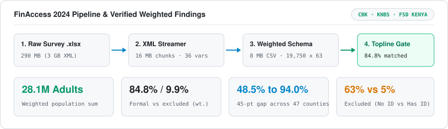

# FinAccess Kenya 2024: Financial Inclusion Dashboard

[](https://github.com/princenzmw/finaccess-kenya-dashboard/actions/workflows/ci.yml)

Weighted county-level analysis of Kenya's 2024 FinAccess Household Survey (CBK, KNBS, and FSD Kenya), paired with a streaming Python ETL pipeline and a 5-page Power BI model.

- [Live Power BI Report](https://app.powerbi.com/view?r=eyJrIjoiYTJjMDVkMmUtZGYxMC00ZTExLTlhZGEtYjcyZTZiNjk1YzhkIiwidCI6IjE2ZDgzZWU2LTI1NGEtNDY5ZC1hNmNjLTU0ZTJjYTIzMTNlNyIsImMiOjh9&embedImagePlaceholder=true&pageName=a09621f88fac873c711f)
- [Case Study on nzamuwe.com](https://nzamuwe.com/projects/finaccess)
- [Source Survey Dataset (KNBS)](https://finaccess.knbs.or.ke/reports-and-datasets)

<picture>
  <source media="(prefers-color-scheme: dark)" srcset="./assets/pipeline-overview-dark.svg" />
  <source media="(prefers-color-scheme: light)" srcset="./assets/pipeline-overview-light.svg" />
  
</picture>

## Why this pipeline exists

The official FinAccess 2024 Excel workbook is ~290 MB (~3 GB of uncompressed XML), which makes direct loading into Excel or Power BI slow and fragile. `prepare_finaccess.py` streams `xl/worksheets/sheet1.xml` directly from the zip archive in 16 MB chunks, filters to adult respondents (`filt == 1`, 19,750 adults representing 28.1M Kenyan adults), selects 36 source variables, computes binary usage flags plus individual survey-weighted columns (`w_* = weight * flag`), and writes an ~8 MB CSV ready for Power BI.

Before finishing, the script checks weighted headline aggregates against the published FinAccess 2024 topline figures and exits with an error if any metric differs by 0.05 percentage points or more.

## Key verified findings

- **Published topline reconciliation:** Weighted results match official figures at 84.8% formal access, 5.2% informal only, and 9.9% excluded. Unweighted formal access is 85.7%, which is why all percentages in the Power BI model use survey weights (`SUM(Survey[w_*]) / SUM(Survey[weight])`) rather than row counts.
- **Regional gap:** County formal financial access ranges from 48.5% to 94.0% across Kenya's 47 counties, a 45-point spread.
- **National ID gap:** Among adults without a national ID, 63% are excluded from formal financial services, compared with 5% among adults who hold an ID.

## Repository contents

| File | Description |
| :--- | :--- |
| `prepare_finaccess.py` | Streaming ETL script that parses the raw 290 MB `.xlsx` survey workbook, applies adult filtering and survey weights, writes analytical CSV outputs, and runs topline reconciliation. |
| `finaccess_kenya_dashboard.pbix` | 5-page Power BI Desktop workbook built on the weighted survey schema. |
| `measures.dax.txt` | Reference copy of the weighted DAX measures, gap calculations, small-sample caution flag (`n < 250`), and dynamic titles used in the report. |
| `data_dictionary.csv` | Column-level schema reference for the 63-column generated adult table (`finaccess_adults.csv`). |

## Reproducing the dataset locally

1. Download the FinAccess 2024 Household Survey workbook from [KNBS](https://finaccess.knbs.or.ke/reports-and-datasets) (check the survey site's terms of use before redistributing raw data).
2. Install Python dependencies:
   ```bash
   pip install -r requirements.txt
   ```
3. Run the streaming ETL script (takes ~30 seconds):
   ```bash
   python prepare_finaccess.py --xlsx "path/to/finaccess_2024.xlsx" --out output
   ```

The script writes four files to `output/` (not committed to git to respect survey redistribution terms):
- `output/finaccess_adults.csv`: 19,750 adult rows, 63 columns including `weight` and `w_*` weighted flags.
- `output/dim_county.csv`: 47 counties with geocoded `map_location` labels and respondent sample sizes.
- `output/data_dictionary.csv`: generated column dictionary.
- `output/reconciliation.csv`: weighted aggregates compared against published FinAccess 2024 toplines.

## Running tests

```bash
pip install -r requirements.txt -r requirements-dev.txt
ruff check .
pytest -v
```

## Usage notes

- Always weight percentages using `SUM(Survey[w_<metric>]) / SUM(Survey[weight])`. Never compute percentages with `COUNTROWS`.
- Cite the FinAccess Household Survey 2024 (CBK, KNBS, FSD Kenya) when presenting figures from this model.
